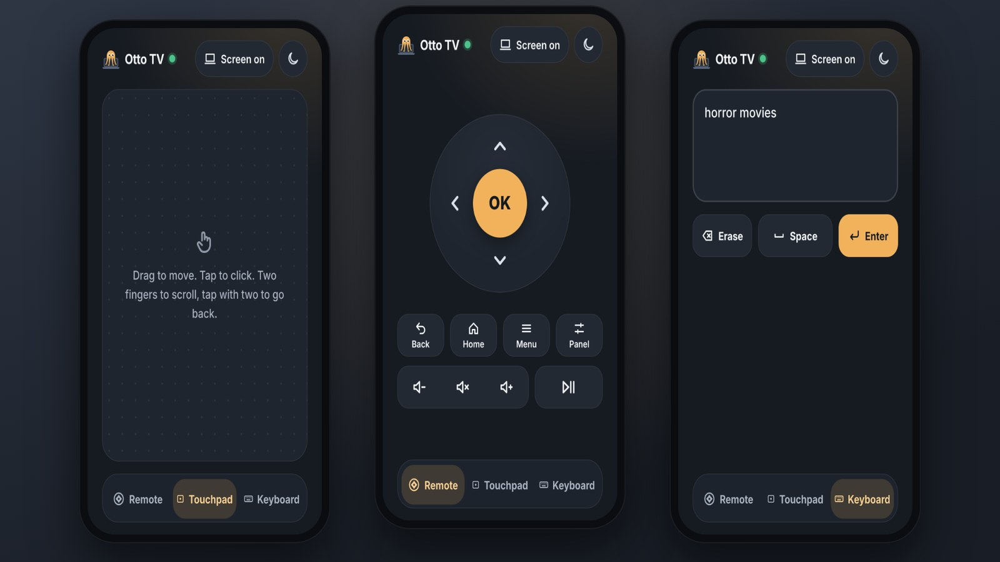
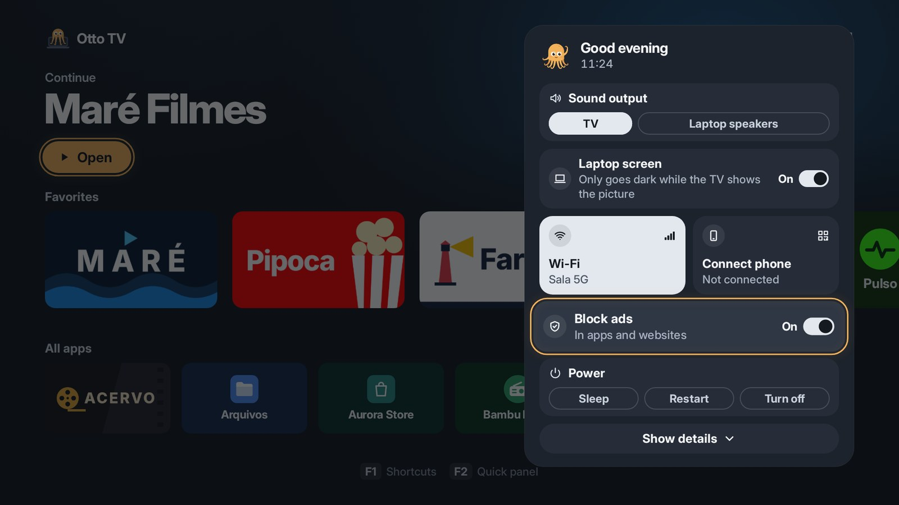
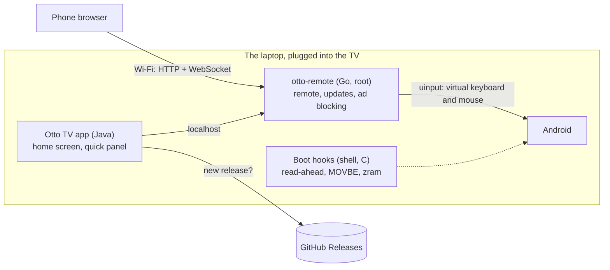
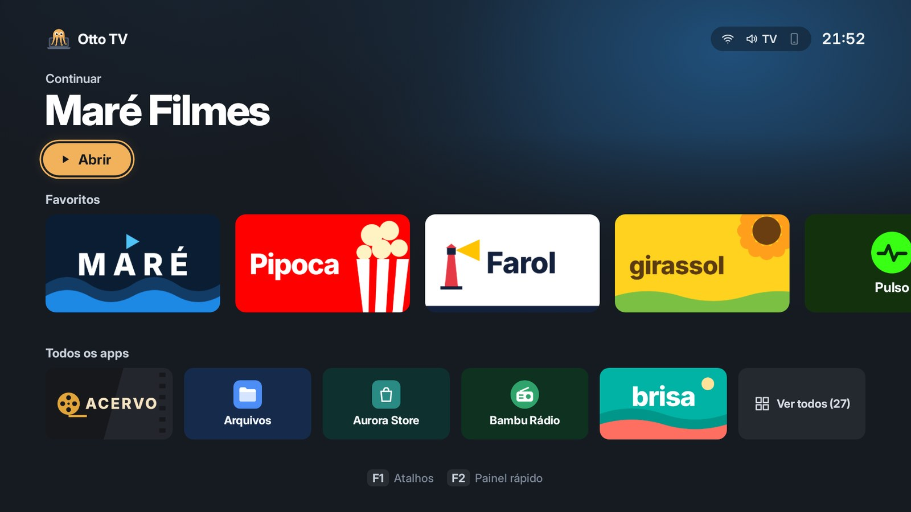
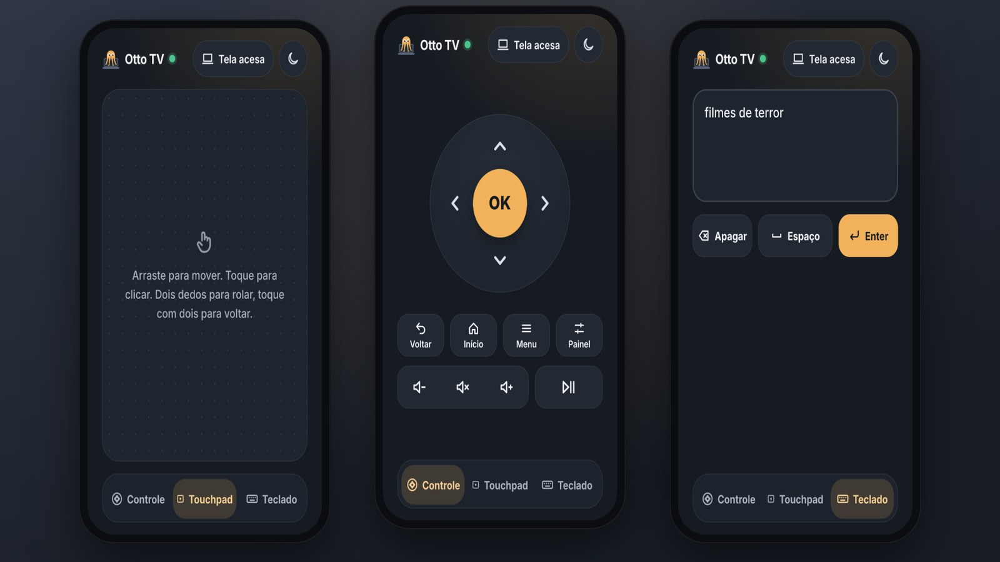
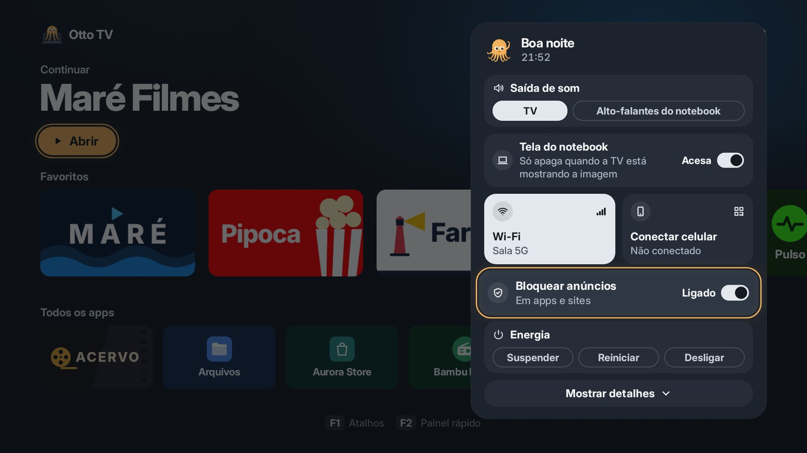
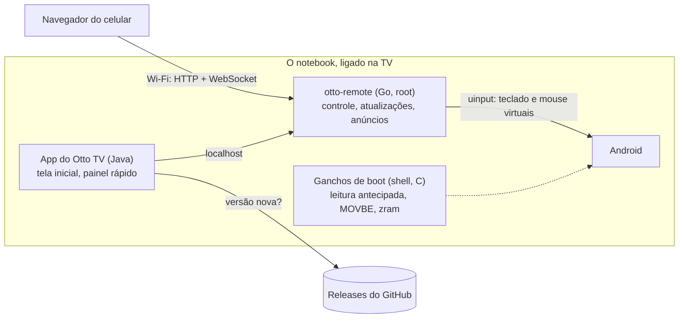

  
  

<b><a href="#english">English</a></b> | <b><a href="#português">Português</a></b>

---

## English

**Otto TV turns an old laptop into a smart TV, and a faster one than the TV
it's plugged into.** Connect it over HDMI, turn it on, and you get a home
screen made for the couch, a remote on your phone, streaming, games, the
whole Play Store catalog and a real web browser. All of it on a 2012 laptop
that was gathering dust.

**[Download the ISO](https://drive.google.com/file/d/1aCdLakNSqOuaPvUmTtjlDD6mi7I2ikdl/view)** (2.7 GB)
| [How to install](#how-to-install) | [How it works](docs/technical.md)

The home screen, shown here with sample apps.

### How it started

My TV is old and slow: its "smart" side takes forever to open anything and
freezes in the middle of an episode. Meanwhile, my old Acer laptop sat around
with nothing to do. So I plugged one into the other and put Android TV on it.
It technically worked, and it was awful: slow to boot, sound coming out of
the wrong place, no remote, and half the screens expecting a TV remote
instead of a laptop. Otto TV started as me fixing that and grew into a whole
product.

### What it does

- **Your phone is the remote.** Scan a QR code and the phone becomes a
  remote, a touchpad and a keyboard, with no app to install. It works
  everywhere, settings and games included, because the TV believes a real
  keyboard and mouse are plugged in. It finds the TV by name
  (`otto-tv.local`) even when the router changes its address.
- **Streaming.** YouTube, Disney+, Crunchyroll, Twitch, Globoplay, Stremio
  and more.
- **Games on the big screen.** Android TV games play with the phone as the
  controller. Beach Buggy Racing runs smooth on a 2012 laptop.
- **The whole Play Store catalog, no Google account.** Aurora Store and
  F-Droid come with it.
- **A real web browser,** with the phone as keyboard and touchpad.
- **Ads blocked everywhere,** in apps and websites, with one switch.
- **Sound that just goes to the TV,** and a laptop screen that goes dark
  while the TV shows the picture.
- **Updates on its own.** Installed TVs pick up new versions from this
  repository, signed so they only install what I published.
- **The laptop's keyboard and mouse work too,** with shortcuts that make
  sense on a TV: Esc goes back, F2 opens the quick panel.

Everything the system needs is one key away in the quick panel: where the
sound goes, the laptop screen, Wi-Fi, pairing a phone, ad blocking and
power.

### Under the hood

This isn't Android TV with a new wallpaper. Measured on the real thing, an
Acer from 2012 (i5-3230M, Intel HD 4000, hard drive):

| | Before | With Otto TV |
|---|---|---|
| Boot to the home screen | 77 s | **40 s** |
| Janky frames on the home screen | 30% | **4%** |
| Back to an app that was open | 1.1 s | **0.06 s** |
| Protected video (Disney+ and others) | crashed | **plays** |

How:

- **Boot read-ahead.** On a hard drive, the boot spent most of its time
  waiting for the disk to seek. Now, after each boot, the TV notes what the
  system read, sorted by where it sits on the disk, and on the next boot it
  reads all of it in long sequential runs before Android asks for it.
- **A home screen drawn by hand.** No stock widgets: the app paints every
  frame itself, and backdrops, shadows and glows are rendered once into GPU
  layers instead of on every frame.
- **A remote with no app.** A Go service running as root creates a virtual
  keyboard and mouse through Linux's uinput, so Android sees ordinary USB
  devices. Pairing needs someone in front of the TV (a QR code, or a PIN
  that only works while it's on screen), and a small mDNS responder written
  from scratch answers for `otto-tv.local`.
- **Signed over-the-air updates.** The TV checks GitHub releases, verifies an
  Ed25519-signed manifest and the archive's SHA-256, installs it and asks
  for a restart. Nobody else, GitHub included, can push an update to a TV.
- **DRM on CPUs missing an instruction.** Android's Widevine service crashed
  on Intel CPUs from before 2013, which lack MOVBE. A C library of under 200
  lines, with no libc at all, catches the illegal instruction, does it in
  software and lets the service carry on.
- **Ad blocking that can't take your internet down.** Android's Private DNS
  points at AdGuard DNS, and a watchdog pauses it, with a notice on the TV,
  on networks that block it.
- **Its own installer, boot menu and boot animation,** with Otto the
  octopus.
- **250+ automated tests** on every push: Go, shell, Java and Python, plus
  the C library running on an emulated Ivy Bridge CPU.

Built with Go, Java (the TV app, built without Gradle), C, shell and Python.
The details are in [docs/technical.md](docs/technical.md).

### How to install

You need a 64-bit PC or laptop from around 2010 or newer (Intel Core
i3/i5/i7, or AMD from 2011 on; Core 2 Duo and older won't work), 2 GB of RAM
(4 GB is better) and an 8 GB USB stick.

1. [Download the ISO](https://drive.google.com/file/d/1aCdLakNSqOuaPvUmTtjlDD6mi7I2ikdl/view)
   (2.7 GB). It's over the 2 GB GitHub allows per file, so it lives on Google
   Drive, which warns it can't scan a file this big for viruses: download it
   anyway. The [release](https://github.com/gmoreno-dev/OttoTV/releases/latest)
   lists its SHA-256 if you want to check it.
2. Write it to a USB stick with Rufus, balenaEtcher or Ventoy.
3. Plug the computer into the TV and boot from the stick. It runs straight
   from the stick, so you can try it without touching anything.
4. Liked it? Pick "Instalar o Otto TV neste computador" in the boot menu
   (the menus are in Portuguese for now). **Installing erases the
   computer's disk.**

You can also build the ISO yourself ([how](docs/technical.md#build)).

### Status

Done, for now: it does what I wanted, and my old TV got a second life. So
far it has run on one machine, my Acer with a Samsung TV, so other PCs are
uncharted. Some streaming apps still don't work: Netflix refuses devices
Google hasn't certified, Prime Video, Max and Apple TV fail for reasons I
haven't pinned down yet, and Globoplay's picture only shows on the laptop
screen. If you try it, open an issue and tell me how it went. I fix bugs
when I can, and installed TVs get the fixes on their own.

### Credits

Otto TV is built on [LineageOS TV x86](https://github.com/LineageOS-TV-x86),
which builds on LineageOS, [Bliss OS](https://blissos.org) and Android-x86.
I don't rebuild Android: I take their image and add my stuff on top. The
bundled apps come from [F-Droid](https://f-droid.org).

---

## Português

**O Otto TV transforma um notebook velho numa smart TV, e mais rápida que a
própria TV onde ele tá ligado.** Liga no HDMI, liga o notebook e pronto: uma
tela inicial feita pro sofá, o celular como controle, streaming, jogos, o
catálogo inteiro da Play Store e um navegador de verdade. Tudo isso num
notebook de 2012 que tava parado pegando poeira.

**[Baixar a ISO](https://drive.google.com/file/d/1aCdLakNSqOuaPvUmTtjlDD6mi7I2ikdl/view)** (2,7 GB)
| [Como instalar](#como-instalar) | [Como funciona](docs/technical.md)

A tela inicial, aqui com apps de exemplo.

### Como começou

Minha TV é velha e lenta: a parte "smart" dela demora uma eternidade pra
abrir qualquer coisa e trava no meio do episódio. Enquanto isso, meu
notebook Acer antigo tava parado, sem uso. Aí liguei um no outro e coloquei
Android TV nele. Funcionar, funcionava, mas era horrível: demorava pra
ligar, o som saía no lugar errado, não tinha controle, e metade das telas
esperava um controle remoto em vez de um notebook. O Otto TV começou comigo
arrumando isso e virou um produto inteiro.

### O que ele faz

- **Seu celular vira o controle.** Escaneia um QR code e o celular vira
  controle, touchpad e teclado, sem instalar nada. Funciona em tudo, até nas
  configurações e nos jogos, porque a TV acha que tem um teclado e um mouse
  de verdade ligados. E ele acha a TV pelo nome (`otto-tv.local`), mesmo
  quando o roteador muda o endereço dela.
- **Streaming.** YouTube, Disney+, Crunchyroll, Twitch, Globoplay, Stremio e
  mais.
- **Jogos na tela grande.** Jogos de Android TV rodam com o celular como
  controle. O Beach Buggy Racing roda liso num notebook de 2012.
- **O catálogo inteiro da Play Store, sem conta Google.** Já vem com a
  Aurora Store e o F-Droid.
- **Um navegador de verdade,** com o celular como teclado e touchpad.
- **Anúncios bloqueados em tudo,** em apps e sites, com um botão só.
- **O som vai pra TV sozinho,** e a tela do notebook apaga enquanto a TV
  mostra a imagem.
- **Se atualiza sozinho.** As TVs instaladas pegam as versões novas deste
  repositório, assinadas, então só instalam o que eu publiquei.
- **O teclado e o mouse do notebook também funcionam,** com atalhos que
  fazem sentido numa TV: Esc volta, F2 abre o painel rápido.

Tudo que o sistema precisa fica a uma tecla, no painel rápido: pra onde vai
o som, a tela do notebook, Wi-Fi, parear um celular, bloqueio de anúncios e
energia.

### Por dentro

Não é um Android TV com papel de parede novo. Medido no aparelho de verdade,
um Acer de 2012 (i5-3230M, Intel HD 4000, HD):

| | Antes | Com o Otto TV |
|---|---|---|
| Ligar até a tela inicial | 77 s | **40 s** |
| Quadros travados na tela inicial | 30% | **4%** |
| Voltar pra um app que tava aberto | 1,1 s | **0,06 s** |
| Vídeo protegido (Disney+ e outros) | travava | **roda** |

Como:

- **Leitura antecipada no boot.** Num HD, o boot passava a maior parte do
  tempo esperando o disco. Agora, depois de cada boot, a TV anota o que o
  sistema leu, na ordem em que está no disco, e no próximo boot lê tudo isso
  de uma vez, em sequência, antes de o Android pedir.
- **Uma tela inicial desenhada na mão.** Nada de componentes prontos: o app
  desenha cada quadro sozinho, e fundo, sombras e brilhos são desenhados uma
  vez só em camadas da GPU, em vez de a cada quadro.
- **Um controle sem app.** Um serviço em Go rodando como root cria um
  teclado e um mouse virtuais pelo uinput do Linux, então o Android enxerga
  dispositivos USB comuns. Parear exige alguém na frente da TV (um QR code,
  ou um PIN que só vale enquanto tá na tela), e um respondedor mDNS escrito
  do zero responde por `otto-tv.local`.
- **Atualizações assinadas pela internet.** A TV olha as releases do GitHub,
  confere um manifesto assinado com Ed25519 e o SHA-256 do arquivo, instala
  e pede pra reiniciar. Ninguém mais, nem o GitHub, consegue mandar uma
  atualização pra TV.
- **DRM em processador sem uma instrução.** O serviço Widevine do Android
  travava em processadores Intel de antes de 2013, que não têm a instrução
  MOVBE. Uma biblioteca em C com menos de 200 linhas, sem libc nenhuma,
  pega a instrução ilegal, faz o trabalho dela por software e deixa o
  serviço seguir.
- **Bloqueio de anúncios que não derruba sua internet.** O DNS privado do
  Android aponta pro AdGuard DNS, e um vigia pausa o bloqueio, com um aviso
  na TV, em redes que não deixam ele funcionar.
- **Instalador, menu de boot e animação de inicialização próprios,** com o
  Otto, o polvo.
- **Mais de 250 testes automáticos** a cada push: Go, shell, Java e Python,
  e a biblioteca em C rodando num processador Ivy Bridge emulado.

Feito com Go, Java (o app da TV, compilado sem Gradle), C, shell e Python.
Os detalhes estão em [docs/technical.md](docs/technical.md) (em inglês).

### Como instalar

Você precisa de um PC ou notebook 64 bits de 2010 pra cá (Intel Core
i3/i5/i7, ou AMD de 2011 em diante; Core 2 Duo e mais antigos não
funcionam), 2 GB de RAM (4 GB é melhor) e um pendrive de 8 GB.

1. [Baixa a ISO](https://drive.google.com/file/d/1aCdLakNSqOuaPvUmTtjlDD6mi7I2ikdl/view)
   (2,7 GB). Ela passa dos 2 GB que o GitHub aceita por arquivo, então fica
   no Google Drive, que avisa que não consegue verificar vírus num arquivo
   desse tamanho: baixa mesmo assim. A
   [release](https://github.com/gmoreno-dev/OttoTV/releases/latest) mostra o
   SHA-256 dela, se você quiser conferir.
2. Grava num pendrive com o Rufus, o balenaEtcher ou o Ventoy.
3. Liga o computador na TV e dá boot pelo pendrive. Ele roda direto do
   pendrive, então dá pra testar sem mexer em nada.
4. Gostou? Escolhe "Instalar o Otto TV neste computador" no menu de boot.
   **Instalar apaga o disco do computador.**

Também dá pra gerar a ISO você mesmo ([como](docs/technical.md#build)).

### Status

Pronto, por enquanto: ele faz o que eu queria, e minha TV velha ganhou uma
segunda vida. Até agora rodou numa máquina só, o meu Acer com uma TV
Samsung, então outros PCs são território desconhecido. Alguns apps de
streaming ainda não funcionam: a Netflix recusa aparelhos que o Google não
certificou, Prime Video, Max e Apple TV falham por motivos que eu ainda não
descobri, e a imagem do Globoplay só aparece na tela do notebook. Se você
testar, abre uma issue e me conta como foi. Eu corrijo bug quando dá, e as
TVs instaladas recebem as correções sozinhas.

### Créditos

O Otto TV é feito em cima do
[LineageOS TV x86](https://github.com/LineageOS-TV-x86), que por sua vez vem
do LineageOS, do [Bliss OS](https://blissos.org) e do Android-x86. Eu não
recompilo o Android: pego a imagem deles e coloco as minhas coisas por cima.
Os apps que vêm junto são do [F-Droid](https://f-droid.org).
